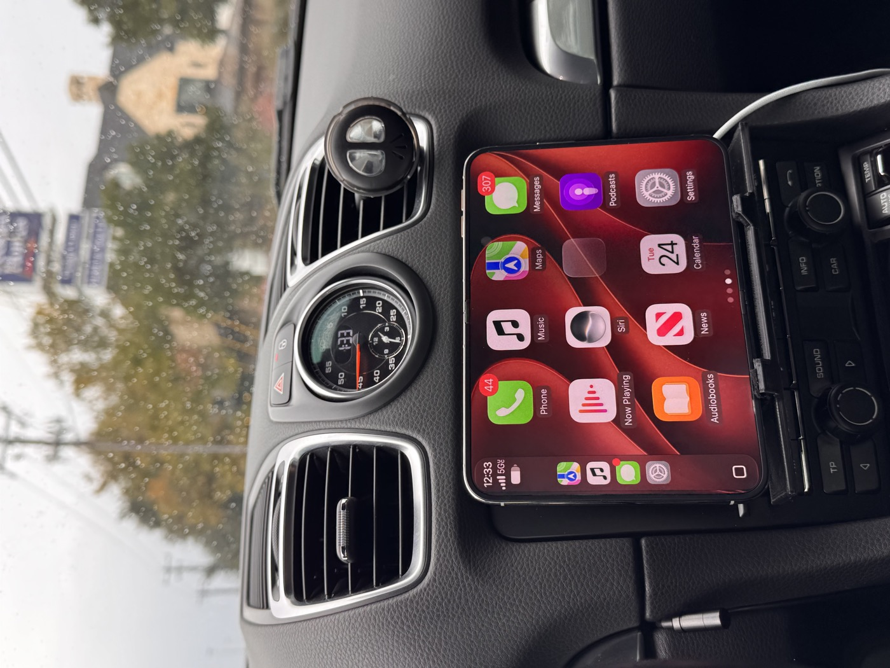
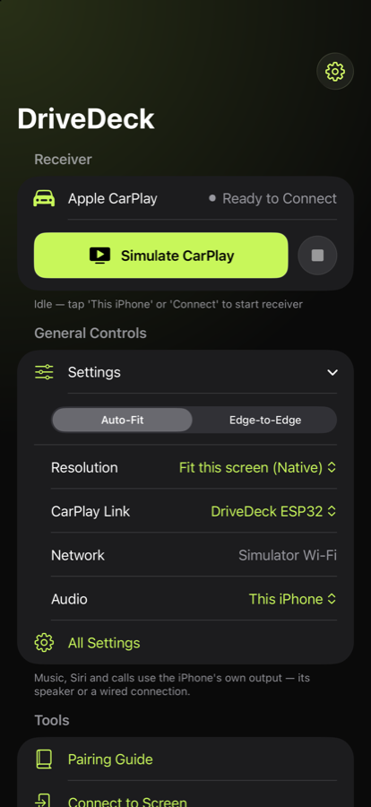
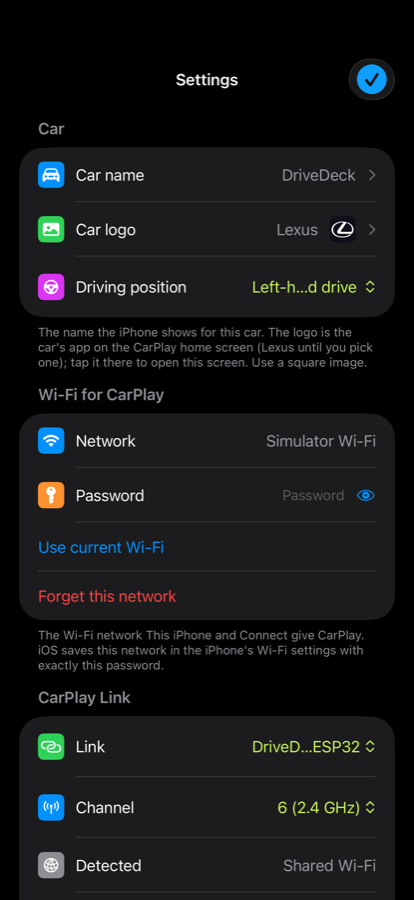
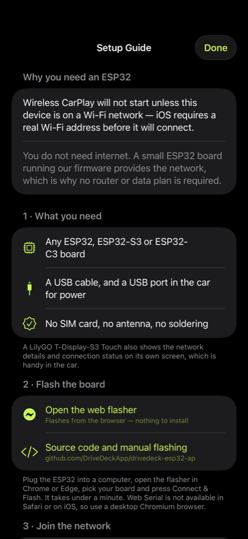
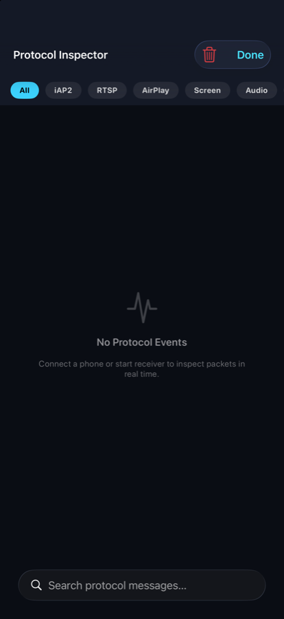

# Install DriveDeck

**Turn a spare iPhone or iPad into a CarPlay-style display for your car.**

---

DriveDeck is a real CarPlay **receiver**, not a simulator. Mount an old iPhone or iPad in your car
and it becomes the display — Maps, Music, Messages, Siri — streamed from the phone in your pocket,
or from the very same device.

> ### 🕙 Everyone gets 10 minutes free
>
> Download and install DriveDeck without paying anything. You get **10 minutes of CarPlay** to
> prove it works on your own devices before you spend a penny. The clock only runs while CarPlay is
> actually streaming, so nothing is wasted while you set things up.
>
> No account, no card, no trial signup.

This guide takes about **15 minutes** end to end.

---

## What it looks like

| Home screen | Settings |
|---|---|
|  |  |

| Setup guide | Connection inspector |
|---|---|
|  |  |

---

## Table of contents

1. [What you'll need](#1--what-youll-need)
2. [Buy and download DriveDeck](#2--buy-and-download-drivedeck)
3. [Sideload it onto your device](#3--sideload-it-onto-your-device)
4. [Flash your ESP32](#4--flash-your-esp32)
5. [Join the network](#5--join-the-network)
6. [First run](#6--first-run)
7. [Activate](#7--activate)
8. [Troubleshooting](#troubleshooting)

---

## 1 · What you'll need

| | Why |
|---|---|
| **A spare iPhone or iPad, iOS 17+** | This is the device you mount in the car. Your everyday phone stays in your pocket. |
| **A Mac or PC** | Needed once, to install the app. iOS cannot install an `.ipa` from a browser. |
| **A Wi-Fi network** | Your home network is fine for testing. Any network will do; it is not used for internet. |
| **An ESP32 board** *(for use in the car)* | Supplies a network where none exists. Not needed to try DriveDeck at home. |
| **An Apple ID** | The sideloading tool re-signs the app with your own account. A free one works. |
| **A USB cable** | To flash the board, and to connect your device to the computer. |

### Do I need the ESP32 to try it?

**No.** Any Wi-Fi network works, including your home network — so you can test DriveDeck indoors
before buying any hardware at all:

1. Join both devices, or the single device, to your **home Wi-Fi**.
2. In the app, set **CarPlay Link** to **Home Wifi**.
3. Enter your home network's name and password in the Wi-Fi fields.
4. Press **Start Receiver**.

That is the fastest way to confirm DriveDeck works on your device.

**The ESP32 is for the car**, where no Wi-Fi exists. It creates a small network on demand so the
connection can start, needs no SIM, router or data plan, and runs off any USB socket. Without it,
DriveDeck works in your driveway and nowhere else.

A travel router works too, if you already own one — the ESP32 is simply the $5 version of the same
idea.

### Which ESP32?

Any ESP32, S2, S3 or C3 will do. No soldering.

- **[Classic ESP32 dev board](https://a.co/d/0bIfPpNL)** — cheapest, and all DriveDeck needs.
- **[LilyGO T-Display-S3 Touch](https://a.co/d/07MaoqIS)** — recommended. Its small screen shows the
  network name and how many devices are connected, which is genuinely useful when something is not
  working and you have no laptop with you.

---

## 2 · Buy and download DriveDeck

### → [drivedeck-carplay.vercel.app](https://drivedeck-carplay.vercel.app/#access)

**$10 once. Lifetime access, including every future update.**

Pay by card, Apple Pay, Link, Klarna or Cash App. You land on a download page straight afterwards.

> **Keep that download link.** It never expires and always serves the newest build, so it is how you
> get updates later. It is also in your receipt email. The link is tied to your purchase — treat it
> like a receipt rather than sharing it.

---

## 3 · Sideload it onto your device

iOS will not open an `.ipa` directly, so this step happens on a computer. The tool re-signs the app
with your own Apple ID.

Any of these work:

| Tool | Platform | Notes |
|---|---|---|
| **[Sideloadly](https://sideloadly.io)** | macOS, Windows | Simplest. Start here. |
| **[AltStore](https://altstore.io)** | macOS, Windows | Can refresh the signature automatically over Wi-Fi, which saves repeating this later. |
| **[Feather](https://github.com/khcrysalis/Feather)** | iOS | On-device, if you would rather not use a computer. |

Using Sideloadly:

1. Install Sideloadly on your Mac or PC and open it.
2. Connect your iPhone or iPad by cable. Tap **Trust** on the device if asked.
3. Drag `DriveDeck.ipa` into the Sideloadly window.
4. Enter your Apple ID and press **Start**. It re-signs and installs the app.
5. On the device, go to **Settings → General → VPN & Device Management** and trust your developer
   certificate.
6. Open DriveDeck.

> **With a free Apple ID the app stops working after 7 days** and you repeat steps 2–4. That is an
> Apple limitation on free accounts, not something DriveDeck controls. A paid Apple Developer
> account lasts a year, and AltStore can refresh it automatically over Wi-Fi.

---

## 4 · Flash your ESP32

### → [Flash it from your browser](https://drivedeck-carplay.vercel.app/#flash)

Under a minute, nothing to install — it uses Web Serial.

1. Open that page **on a desktop in Chrome, Edge or Opera**. Safari and Firefox do not support Web
   Serial, and neither does any browser on iOS.
2. Plug the ESP32 into the computer with a USB cable.
3. Pick your board from the dropdown.
4. Press **Connect & Flash**, choose the serial port — usually named `usbmodem`, `USB Serial` or
   `CP210x` — then **Install**, and confirm erasing the device.

Firmware source and manual flashing instructions:
**[drivedeck-esp32-ap](https://github.com/DriveDeckApp/drivedeck-esp32-ap)**

Once flashed, the board broadcasts:

| | |
|---|---|
| Network | `DriveDeckAP` |
| Password | `drivedeck123` |
| Channel | 6 |

Power it from any USB source in the car.

---

## 5 · Join the network

On the device you are mounting in the car, go to **Settings → Wi-Fi** and join **`DriveDeckAP`**.

iOS will warn there is no internet connection. **That is expected and harmless** — the board exists
only to hand out an address. iOS remembers the network and rejoins automatically whenever the board
is powered and nearby.

---

## 6 · First run

1. Open DriveDeck.
2. Under **General Controls**, set **CarPlay Link** to **DriveDeck ESP32**. The network name,
   password and channel fill in automatically.
3. **Turn Personal Hotspot OFF** on this device, in Settings → Personal Hotspot. This is the single
   most common reason setup fails: hosting a hotspot occupies the same radio the link needs.
4. Press **Start Receiver**.

The dashboard appears within a few seconds.

**To get back to the app from the CarPlay screen**, tap anywhere with **three fingers**, or tap the
DriveDeck icon on the CarPlay home screen.

### Optional: open automatically

The app links to an Apple Shortcut that opens DriveDeck as soon as your device joins the
`DriveDeckAP` network, so powering the board starts everything. It is on the home screen under
**Auto-open with Shortcuts**.

iOS gives an app no way to launch itself on a Wi-Fi change, which is why this is a Shortcut rather
than a setting.

---

## 7 · Activate

You get **10 minutes of CarPlay free** to confirm everything works. After that the app asks you to
activate.

**Your activation code is the email address you paid with.** There is nothing else to keep track of.

1. Open **Settings → Activate DriveDeck** in the app, or wait for the prompt.
2. Enter the email you used at checkout.
3. Press **Activate**.

This needs an internet connection once. After that the app stays unlocked permanently, including
through reinstalls and re-signing.

> **One purchase activates one device.** Entering the same email on a second device is refused. You
> can remove an activation in **Settings → Remove activation**, but note that this does not restore
> the free trial.

---

## Troubleshooting

<strong>Stuck on "Waiting for iPhone"</strong>

In order of likelihood:

1. **Personal Hotspot is on.** Turn it off. This is the most common cause by a wide margin.
2. **Not joined to `DriveDeckAP`.** Check Settings → Wi-Fi. The "no internet" warning is fine.
3. **The ESP32 has no power.** Its LED should be lit; on the T-Display-S3 the screen shows the
   network name.
4. **Wrong credentials in the app.** Set CarPlay Link to **DriveDeck ESP32** to refill them.
5. Open the app's **Connection Inspector** — it shows exactly which step of the handshake is
   failing.

<strong>No audio, or audio comes out of the wrong place</strong>

Audio plays through the **phone's own output**, by design, and reaches your car stereo over
Bluetooth exactly as it normally would. Connect the device to your car's Bluetooth as usual.

If it comes out of the device's own speaker, the Bluetooth connection has dropped — reconnect it in
Settings → Bluetooth.

<strong>Black bars around the dashboard</strong>

The advertised resolution does not match your screen's aspect ratio. Set **Display** to
**Edge-to-Edge**, or pick a **Resolution** matching your device, in Settings.

<strong>Taps land on the wrong icon</strong>

Restart the receiver. The touch coordinate space is locked when the session starts, so changing
resolution mid-session leaves it mismatched.

<strong>The app stopped working after a week</strong>

Free Apple IDs sign apps for 7 days only. Re-run your sideloading tool to refresh it; AltStore can
do this automatically over Wi-Fi, and a paid Apple Developer account extends it to a year.

Your activation is not affected — it survives re-signing.

<strong>"This purchase is already activated on another device"</strong>

One purchase covers one device. If you have changed phones, or activated the wrong device,
[open an issue](https://github.com/DriveDeckApp/InstallDriveDeck/issues/new) with the email you paid
with and we will reset it.

<strong>Lost the download link</strong>

It is in the receipt email from your purchase. If you cannot find it,
[open an issue](https://github.com/DriveDeckApp/InstallDriveDeck/issues/new) with the email address
you paid with.

---

## Links

| | |
|---|---|
| **Buy / download** | [drivedeck-carplay.vercel.app](https://drivedeck-carplay.vercel.app/#access) |
| **ESP32 web flasher** | [drivedeck-carplay.vercel.app/#flash](https://drivedeck-carplay.vercel.app/#flash) |
| **Firmware source** | [drivedeck-esp32-ap](https://github.com/DriveDeckApp/drivedeck-esp32-ap) |
| **Report an issue** | [Open an issue](https://github.com/DriveDeckApp/InstallDriveDeck/issues/new) |
| **Classic ESP32** | [Amazon](https://a.co/d/0bIfPpNL) |
| **T-Display-S3 Touch** | [Amazon](https://a.co/d/07MaoqIS) |

---

DriveDeck is an independent project. It is not affiliated with, authorised by, or endorsed by
Apple Inc. CarPlay is a trademark of Apple Inc.

